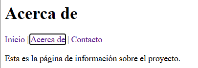
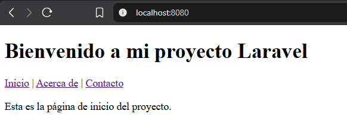
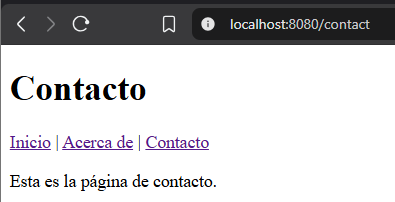

# Tema 01: Instalacion con Docker

| | |
|---|---|
| **Fecha de inicio** | 09/11/2026 |
| **Fecha de fin** | 16/11/2026 |
| **Tiempo dedicado** | 5 horas |
| **Rama de Git** | `tema01` |

---

## 1. 🎯 Objetivo del tema

Instalacion del proyecto con Docker y creacion del proyecto laravel.

---

## 2. 🛠️ Desarrollo paso a paso

<!-- Un apartado por cada paso importante. Para cada uno:
     - Qué haces y POR QUÉ.
     - El comando o el código, en un bloque de código (nunca como captura).
     - Una captura solo si aporta algo visual (navegador, resultado, estructura...). -->

### 2.1 Creacion de vistas

Se van a crear 3 vistas llamadas : home ,about , contact.

Vista *about.blade.php*

```php
<!DOCTYPE html>
<html lang="es">
<head>
    <meta charset="UTF-8">
    <meta name="viewport" content="width=device-width, initial-scale=1.0">
    <title>Acerca de</title>
</head>
<body>
    <h1>Acerca de</h1>
    <nav>
        <a href="/">Inicio</a> |
        <a href="/about">Acerca de</a> |
        <a href="/contact">Contacto</a>
    </nav>
    <p>Esta es la página de información sobre el proyecto.</p>
</body>
</html>
```

Vista *home.blade.php*

```php
<!DOCTYPE html>
<html lang="es">
<head>
    <meta charset="UTF-8">
    <meta name="viewport" content="width=device-width, initial-scale=1.0">
    <title>Inicio</title>
</head>
<body>
    <h1>Bienvenido a mi proyecto Laravel</h1>
    <nav>
        <a href="/">Inicio</a> |
        <a href="/about">Acerca de</a> |
        <a href="/contact">Contacto</a>
    </nav>
    <p>Esta es la página de inicio del proyecto.</p>
</body>
</html>
```

Vista *contact.blade.php*

```php
<!DOCTYPE html>
<html lang="es">
<head>
    <meta charset="UTF-8">
    <meta name="viewport" content="width=device-width, initial-scale=1.0">
    <title>Contacto</title>
</head>
<body>
    <h1>Contacto</h1>
    <nav>
        <a href="/">Inicio</a> |
        <a href="/about">Acerca de</a> |
        <a href="/contact">Contacto</a>
    </nav>
    <p>Esta es la página de contacto.</p>
    
</body>
</html>
```


### 2.2 Definicion de rutas

Se modifica el fichero *routes/web.php* de la siguiente forma :
```php
Route::view('/', 'landing.home')->name('home');
Route::view('/contact', 'landing.contact')->name('contact');
Route::view('/about', 'landing.about')-> name('about');
```
---

## 3. 📋 Resumen de comandos utilizados

| Comando | Para qué sirve |
|---------|----------------|
| `composer ...` | Gestor de dependencias de PHP. Se usa para instalar Laravel y sus paquetes necesarios.|
| `docker-compose ` | Herramienta para definir y ejecutar contenedores Docker. Útil para crear un entorno de desarrollo con Laravel.|

---

## 4. 🐞 Problemas encontrados y soluciones

<!-- Documenta TODOS los problemas, aunque te parezcan tontos.
     Copia el error como texto, no como captura.
     Si no has tenido ningún problema, documenta al menos algo que hayas tenido que investigar. -->

### Problema 1: Comprobacion del funcionamento de laravel despues de su instalacion

**Qué estaba haciendo:** Comprobar el correcto funcionamento de laravel una vez creado el proyecto basico.

**Error:**

```
Acceso denegado
```

**Causa:** Posible problema de permisos .

**Solución:**

Ejecutamos en una terminal los seguientes comandos :

```bash
docker exec -it proyecto-php-1 bash
php artisan key:generate
chmod -R 775 storage bootstrap/cache
chown -R www-data:www-data storage bootstrap/cache
```

Poateriormente sera necesario añadir en el fichero *.env* la siguiente configuracion:
```bash
Fichero .env:
DB_HOST=mysql
DB_PORT=3306
DB_DATABASE=test
DB_USERNAME=alumno
DB_PASSWORD=alumno

SESSION_DRIVER=file
 
```

**Fuente:** chatGPT.


## 5. ✅ Resultado final

<!-- Captura(s) de la aplicación funcionando al terminar el tema. -->


Vista *about.blade.php*



Vista *home.blade.php*



Vista *contact.blade.php*



---

## 6. 💭 Conclusiones

- **Qué he aprendido:** he aprendido laravel.
- **Qué me ha costado más:** nada
- **Qué haría diferente / dudas pendientes:** nada .